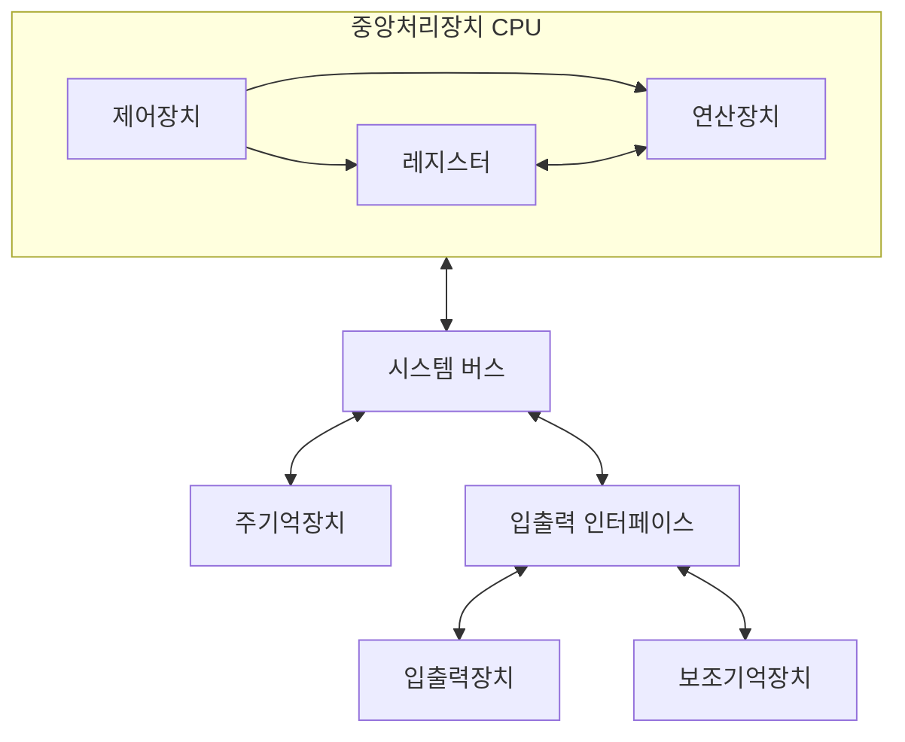

# 01. 컴퓨터 구조의 기초

[목차로 돌아가기](./README.md) · [다음: 데이터 표현과 컴퓨터 산술](./02_데이터_표현과_컴퓨터_산술.md)

선수 개념 : 비트(bit, 0 또는 1을 나타내는 단위), 바이트(byte, 8비트).

## 1. 본문 개념 설명

### 1.1 컴퓨터가 하는 일과 기본 구성

컴퓨터 : 입력받은 데이터를 명령어에 따라 처리하고 결과를 저장·출력하는 장치.

- 데이터 : 처리 대상이 되는 값. 예) 계좌 잔액
- 명령어 : 컴퓨터가 수행할 동작을 지정하는 코드. 예) 덧셈, 저장

컴퓨터의 5대 기능 : 입력, 기억, 연산, 제어, 출력. 이 중 연산과 제어를 담당하는 중심 장치가 CPU다.

| 구성 요소 | 하는 일 | 예시 |
|---|---|---|
| 중앙처리장치(CPU, Central Processing Unit) | 명령어를 해석하고 연산 및 데이터 이동을 수행. | 덧셈, 비교, 분기, 메모리 읽기·쓰기 |
| 주기억장치(Main Memory) | 실행에 필요한 명령어와 데이터를 보관. | 일반적인 시스템의 RAM |
| 보조기억장치(Secondary Storage) | 프로그램과 데이터를 장기간 보관. | SSD, HDD |
| 입력장치 | 외부 정보를 컴퓨터에 전달. | 키보드, 마우스, 스캐너 |
| 출력장치 | 처리 결과를 외부에 전달. | 모니터, 프린터 |

입출력 기능을 함께 수행하는 장치도 있다. 예를 들어 네트워크 인터페이스는 데이터를 보내기도 하고 받기도 한다. 따라서 모든 장치를 입력 전용 또는 출력 전용으로만 나눌 수 있는 것은 아니다.

#### 컴퓨터의 구성

장치 구성과 정보 이동 경로



Mermaid 그림이 표시되지 않는 환경에서는 `CPU ↔ 시스템 버스 ↔ 주기억장치·입출력 인터페이스`의 관계로 읽으면 된다.

### 1.2 CPU 내부: 연산장치, 제어장치, 레지스터

CPU 내부는 크게 연산장치, 제어장치, 레지스터로 구성된다.

- 연산장치(ALU, Arithmetic Logic Unit) : 덧셈·뺄셈 등의 산술 연산과 AND·OR·비교 등의 논리 연산을 수행하는 CPU의 구성 요소.
- 제어장치(CU, Control Unit) : 명령어를 해석하고 각 구성 요소의 동작 순서와 데이터 이동을 제어하는 장치.
- 레지스터(Register) : 연산할 값, 주소, 명령어 등을 임시 보관하는 CPU 내부의 작은 고속 저장 공간.

동작 예 : 덧셈 명령어 실행

1. 제어장치가 피연산자를 준비하고 ALU에 덧셈을 지시한다.
2. ALU가 연산을 수행하고 결과 및 상태 정보(0, 음수, 오버플로 등)를 만든다.
3. 제어 신호에 따라 결과를 지정된 레지스터 등에 저장한다.

레지스터의 특징 : 주기억장치보다 용량은 작지만 CPU가 빠르게 접근 가능.

| 레지스터 | 의미 | 기본적인 역할 |
|---|---|---|
| PC | Program Counter | 기본 실행 모델에서 다음에 인출할 명령어의 주소를 보관. |
| IR | Instruction Register | 현재 해석·실행할 명령어를 보관. |
| MAR | Memory Address Register | 읽거나 쓸 메모리 위치의 주소를 보관. |
| MDR 또는 MBR | Memory Data/Buffer Register | 메모리에서 읽은 값 또는 메모리에 쓸 값을 보관. |
| 범용 레지스터 | General-Purpose Register | 피연산자, 연산 결과, 주소 등을 보관. |

이 표는 동작 원리를 설명하기 위한 기본 모델이다. 실제 CPU마다 레지스터의 이름과 내부 구성이 다르며, 위의 모든 레지스터가 프로그래머에게 직접 보이는 것은 아니다.

구분 : **PC는 명령어 주소, IR은 명령어 자체**를 저장. MAR는 메모리 접근 주소, MDR는 메모리와 주고받는 값을 저장.

### 1.3 주기억장치와 보조기억장치

일반적인 실행 경로 : 보조기억장치 → 주기억장치 → CPU.

SSD나 HDD에 저장된 프로그램 중 실행에 필요한 부분을 주기억장치에 적재하고 CPU가 명령어를 인출한다.

- 휘발성 기억장치 : 전원이 끊기면 저장 내용이 사라지는 기억장치. 예) DRAM
- 비휘발성 기억장치 : 전원이 없어도 저장 내용을 유지하는 기억장치. 예) SSD, HDD, ROM, 플래시 메모리

기억장치 계층 : 속도·용량·비용을 고려해 여러 종류의 기억장치를 단계적으로 배치한 구성.

```text
CPU 레지스터 → 캐시 → 주기억장치 → 보조기억장치
      일반적으로 오른쪽으로 갈수록 용량은 커지고 접근시간은 길어진다.
```

캐시(Cache) : 자주 사용할 가능성이 높은 명령어와 데이터의 사본을 보관하는 고속 기억장치.

주기억장치에 매번 접근하는 부담을 줄이는 역할을 한다. 적중률과 매핑 방식은 07단원에서 다룬다.

### 1.4 주소, 데이터, 버스

- 주소(Address) : 메모리의 특정 저장 위치를 식별하는 번호.
- 데이터(Data) : 해당 위치에 저장된 내용.

예 : 주소 100에 숫자 7이 저장되어 있다면 위치를 지정하는 값은 100, 그 위치에서 읽는 데이터는 7.

버스(Bus) : 장치 사이에서 주소·데이터·제어 정보를 전달하는 공통 통로.

시스템 버스는 전달하는 정보에 따라 주소 버스, 데이터 버스, 제어 버스로 구분한다.

| 버스 | 전달하는 정보 | CPU가 메모리에 접근하는 기본 모델 |
|---|---|---|
| 주소 버스 | 접근 대상의 주소 | CPU가 메모리 쪽으로 주소를 보낸다. |
| 데이터 버스 | 명령어 또는 데이터 | 읽기에서는 메모리 → CPU, 쓰기에서는 CPU → 메모리로 전달. |
| 제어 버스 | 읽기·쓰기, 인터럽트, 준비 완료 등의 제어 정보 | 신호의 종류에 따라 방향이 다르다. |

명령어도 비트로 저장되므로 인출할 때는 데이터 버스를 통해 전달될 수 있다. ‘데이터 버스에는 수치 데이터만 흐른다’는 설명은 맞지 않는다.

주소 버스가 n비트라면 서로 다른 주소는 최대 2ⁿ개 표현할 수 있다. 여기서 주소 하나가 몇 바이트를 가리키는지 확인해야 용량을 구할 수 있다.

> 주소로 지정할 수 있는 전체 용량 = 주소 개수 × 주소 하나가 가리키는 저장 단위

주소 하나가 1바이트를 가리키는 바이트 주소 지정 방식에서는 n비트 주소로 2ⁿ바이트를 지정할 수 있다. 주소 하나가 16비트 워드를 가리킨다면 같은 주소 개수로 2ⁿ × 2바이트를 지정한다. 이것은 주소 공간의 크기이며, 실제로 그만큼의 메모리가 장착되어 있다는 뜻은 아니다.

또한 데이터 버스가 32비트라고 해서 주소 버스도 반드시 32비트인 것은 아니다. 한 번에 전달하는 데이터의 폭과 주소를 표현하는 비트 수는 구분해야 한다.

#### 예제: 주소 공간과 전송 폭

조건 : 주소 버스 20비트, 바이트 주소 지정.

```text
주소 개수 = 2²⁰개
지정 가능한 용량 = 2²⁰ × 1바이트 = 1 MiB
주소 범위 = 0 ~ 2²⁰ - 1
```

데이터 버스가 16비트라면 한 번의 데이터 전송으로 2바이트를 전달할 수 있다. 정렬이나 프로토콜의 추가 제약을 무시하고 전송마다 전체 폭을 사용한다면 8바이트를 보내는 데 필요한 전송 횟수는 `8 ÷ 2 = 4회`다. 주소 공간 계산에 데이터 버스 폭을 곧바로 곱하지 않도록 주의한다.

단위는 `1 KiB = 2¹⁰ B`, `1 MiB = 2²⁰ B`를 사용한다. SI 단위인 `1 kB = 10³ B`, `1 MB = 10⁶ B`와 구분하며, 문제에서 별도 기준을 주면 그 기준을 따른다.

### 1.5 프로그램 내장 방식과 폰 노이만 구조

프로그램 내장 방식(Stored-Program Concept) : 명령어를 메모리에 저장하고 CPU가 이를 읽어 실행하는 방식.

장치의 배선을 바꾸지 않고 저장된 프로그램을 바꾸어 다른 작업을 수행할 수 있다.

폰 노이만 구조(Von Neumann Architecture) : 명령어와 데이터를 같은 메모리에 저장하고 접근 경로를 공유하는 구조.

같은 비트열이라도 명령어로 인출해 해석하는지, 연산 대상 데이터로 읽는지에 따라 의미가 달라진다.

폰 노이만 병목 : CPU와 메모리 사이의 전송 속도·대역폭이 전체 처리 성능을 제한하는 현상.

명령어 인출과 데이터 접근이 공유 경로에서 경합할 수 있다. CPU가 빨라도 필요한 정보를 제때 전달받지 못하면 대기 시간이 발생한다.

### 1.6 하버드 구조

하버드 구조(Harvard Architecture) : 명령어용 메모리와 데이터용 메모리, 각각의 접근 경로를 분리한 구조.

- 명령어 인출과 데이터 접근의 동시 수행 가능
- 명령어용·데이터용 메모리 폭을 서로 다르게 설계 가능

| 비교 기준 | 전형적인 폰 노이만 구조 | 전형적인 하버드 구조 |
|---|---|---|
| 명령어·데이터 저장 공간 | 함께 사용 | 분리 |
| 접근 경로 | 공유 | 분리 |
| 명령어 인출과 데이터 접근 | 공유 경로에서 경합 가능 | 서로 다른 경로로 동시 접근 가능 |
| 설계상 특징 | 저장 공간을 통합해 사용 | 경로와 메모리를 별도로 구성 |

현대 시스템은 두 구조의 특징을 섞어 사용하기도 한다. 예를 들어 주기억장치는 통합하면서 CPU 가까이에는 명령어 캐시와 데이터 캐시를 나눌 수 있다. 따라서 ‘명령어 캐시와 데이터 캐시가 분리되어 있으므로 시스템 전체의 주소 공간도 반드시 분리되어 있다’고 판단하면 안 된다. 구조의 구분과 혼합 형태는 [NJIT 컴퓨터 구조 강의 자료](https://web.njit.edu/~alexg/courses/cs345/handouts/h2345f16.pdf)를 참고했다.

#### 두 구조의 접근 경로

```text
폰 노이만 구조
CPU ←──── 공유 경로 ────→ [명령어 + 데이터 메모리]

하버드 구조
CPU ←──── 명령어 경로 ──→ [명령어 메모리]
CPU ←──── 데이터 경로 ──→ [데이터 메모리]
```

### 1.7 프로그램 실행의 기본 흐름

실행 순서 : 인출 → 해독 → 실행 → 결과 반영.

1. 인출(Fetch) : PC가 가리키는 위치에서 명령어를 가져오는 단계.
2. 해독(Decode) : 연산의 종류와 피연산자의 위치를 해석하는 단계.
3. 실행(Execute) : 연산·데이터 이동·분기 등 지정된 동작을 수행하는 단계.
4. 결과 반영 : 필요한 레지스터나 메모리에 결과를 기록하는 단계.

모든 명령어가 메모리에 결과를 쓰는 것은 아니다. 레지스터에만 결과를 남기거나, 비교 결과를 상태 정보에 반영하거나, PC를 바꾸는 명령어도 있다.

순차 실행에서는 PC가 다음 명령어를 가리키도록 갱신된다. 하지만 PC가 항상 1씩 증가하는 것은 아니다. 바이트 주소 지정이고 명령어 길이가 4바이트라면 다음 명령어 주소는 보통 현재 주소에 4를 더한 값이다. 분기나 점프가 실행되면 PC는 지정된 목적지 주소로 바뀐다.

#### 예제: 명령어가 실행되는 과정

조건 : 바이트 주소 지정, 명령어 길이 4바이트. 아래 명령어는 설명용 가상 문법.

| 주소 | 저장된 명령어 | 의미 |
|---|---|---|
| 100 | `LOAD R1, [500]` | 주소 500의 값을 R1으로 읽는다. |
| 104 | `ADD R1, R2` | R1과 R2를 더해 R1에 저장한다. |
| 108 | `STORE [504], R1` | R1의 값을 주소 504에 저장한다. |

초기 상태는 `PC = 100`, `M[500] = 7`, `R2 = 5`다. `M[x]`는 주소 x에 저장된 값을 뜻한다. 각 데이터는 해당 위치에 겹치지 않게 저장되어 있다고 가정한다.

1. 주소 100의 명령어를 인출하고, 순차 실행을 위해 PC를 104로 갱신한다.
2. `LOAD`를 해석하고 주소 500의 값 7을 읽어 R1에 넣는다.
3. 주소 104의 `ADD`를 인출한다. R1의 7과 R2의 5를 더해 R1에 12를 저장한다.
4. 주소 108의 `STORE`를 인출한다. R1의 12를 주소 504에 기록한다.

실행 후에는 `R1 = 12`, `M[504] = 12`다. `LOAD`는 원래 메모리 값을 지우는 동작이 아니므로 `M[500]`은 여전히 7이다.

## 2. 핵심 비교와 혼동 포인트

| 헷갈리는 내용 | 구분할 점 |
|---|---|
| CPU와 ALU | ALU는 CPU의 구성 요소다. CPU에는 제어 및 저장 기능도 있다. |
| 레지스터와 주기억장치 | 둘 다 값을 저장하지만 위치, 용량, 접근 속도, 용도가 다르다. |
| PC와 IR | PC는 명령어의 주소, IR은 인출한 명령어를 담는다. |
| 주소와 데이터 | 주소는 위치를 지정하고 데이터는 그 위치의 내용이다. |
| 주소 버스와 데이터 버스 | 주소의 가짓수와 한 번에 전달하는 데이터 폭은 별개다. |
| 프로그램 내장과 순차 실행 | 프로그램을 메모리에 저장해도 분기·반복 실행이 가능하다. |
| 주기억장치와 휘발성 | 일반적인 주기억장치용 DRAM은 휘발성이지만 모든 메모리가 휘발성인 것은 아니다. |
| 하버드 구조와 성능 | 동시 접근에 유리한 구조지만 모든 프로그램에서 무조건 더 빠르다는 뜻은 아니다. |

주소 버스의 방향은 이 단원에서 CPU가 버스를 제어하는 기본 상황을 기준으로 설명했다. DMA처럼 다른 장치가 버스 사용권을 얻는 경우까지 포함하면 ‘주소는 언제나 CPU만 보낸다’고 할 수 없다. 이 부분은 09단원에서 다시 다룬다.

## 3. 예시 문제

문제 유형 : 예상문제

### 문제 1. CPU의 구성

명령어를 해석하고 각 구성 요소가 동작하도록 제어 신호를 만드는 장치는?

① ALU　② 제어장치　③ 보조기억장치　④ 출력장치

### 문제 2. 레지스터

다음에 인출할 명령어의 주소와 현재 인출한 명령어를 각각 저장하는 레지스터를 순서대로 고르면?

① IR, PC　② MAR, MDR　③ PC, IR　④ MDR, MAR

### 문제 3. 기억장치

일반적인 컴퓨터의 기억장치에 대한 설명으로 옳은 것은?

① SSD는 전원이 끊기면 모든 저장 내용이 사라진다.
② 레지스터는 주기억장치보다 일반적으로 용량이 크다.
③ 실행에 필요한 프로그램의 일부는 보조기억장치에서 주기억장치로 적재될 수 있다.
④ CPU는 모든 명령어 실행 결과를 반드시 SSD에 기록한다.

### 문제 4. 구조 비교

전형적인 하버드 구조의 특징으로 가장 적절한 것은?

① 명령어와 데이터가 반드시 하나의 접근 경로를 공유한다.
② 명령어 메모리와 데이터 메모리 및 접근 경로를 분리한다.
③ 프로그램을 메모리에 저장할 수 없다.
④ 모든 명령어의 실행시간이 반드시 같다.

### 문제 5. 주소 공간

주소 버스가 24비트이고 바이트 주소 지정을 사용하는 시스템의 최대 주소 공간은? 메모리 예약 영역 등은 고려하지 않는다.

① 2 MiB　② 8 MiB　③ 16 MiB　④ 32 MiB

### 문제 6. PC의 변화

바이트 주소 지정 방식에서 모든 명령어의 길이는 4바이트다. 주소 200의 명령어가 분기 없이 실행될 때 순차적으로 다음에 인출할 명령어의 주소는?

① 201　② 202　③ 204　④ 208

### 문제 7. 버스

버스에 대한 설명으로 옳지 않은 것은?

① 주소 버스는 접근할 위치를 전달한다.
② 데이터 버스로 명령어를 전달할 수 있다.
③ 제어 버스로 읽기·쓰기 신호를 전달할 수 있다.
④ 데이터 버스가 64비트이면 주소 버스도 반드시 64비트다.

### 문제 8. 실행 결과

1.7절의 가상 명령어를 사용한다. 초기 상태가 `M[500] = 9`, `R2 = 4`일 때 `LOAD R1, [500]`, `ADD R1, R2`, `STORE [504], R1`을 차례로 실행했다. 실행 후 R1, M[500], M[504]의 값을 각각 쓰시오.

## 4. 정답과 해설

### 문제 1 — ②

제어장치는 명령어를 해석하고 실행에 필요한 제어 신호를 만든다. ① ALU는 산술·논리 연산을 담당한다. ③ 보조기억장치는 프로그램과 데이터를 장기 보관하며, ④ 출력장치는 처리 결과를 외부로 전달한다.

### 문제 2 — ③

PC에는 다음 명령어의 주소, IR에는 인출한 명령어가 들어간다. ①은 둘의 역할을 뒤집었다. ②의 MAR와 MDR은 메모리 접근 주소와 전송할 값을 보관하는 레지스터다. ④는 그 순서를 바꾼 것으로 역시 질문의 역할과 맞지 않는다.

### 문제 3 — ③

프로그램 전체를 한꺼번에 올리지 않더라도 실행에 필요한 부분을 주기억장치에 적재할 수 있다. ① SSD는 비휘발성이다. ② 레지스터는 일반적으로 매우 작은 저장 공간이다. ④ 결과는 레지스터나 주기억장치 등에 남을 수 있으며 매번 SSD에 기록하지 않는다.

### 문제 4 — ②

하버드 구조는 명령어와 데이터의 저장 공간 및 경로를 나눈다. ①은 전형적인 폰 노이만 구조의 특징이다. ③ 하버드 구조에서도 명령어를 메모리에 저장한다. ④ 메모리 구분만으로 명령어 실행시간이 모두 같아지지는 않는다.

### 문제 5 — ③

`2²⁴개 주소 × 1 B = 2²⁴ B = 2⁴ MiB = 16 MiB`다. ① 2 MiB, ② 8 MiB, ④ 32 MiB는 각각 21비트, 23비트, 25비트의 바이트 주소 공간에 해당한다.

### 문제 6 — ③

주소의 단위가 바이트이고 명령어가 4바이트이므로 `200 + 4 = 204`다. ①은 명령어 길이를 무시하고 1을 더한 값이다. ②는 2바이트 명령어일 때의 증가량이며, ④는 4바이트 명령어 두 개만큼 이동한 값이다.

### 문제 7 — ④

데이터 버스 폭과 주소 버스 폭은 독립적으로 정할 수 있다. ① 주소는 접근 위치를 지정한다. ② 명령어도 메모리에서 읽어 전달하는 비트열이다. ③ 읽기·쓰기 신호는 대표적인 제어 신호다.

### 문제 8 — R1 = 13, M[500] = 9, M[504] = 13

`LOAD` 후 R1은 9가 된다. `ADD` 후에는 `9 + 4 = 13`이 R1에 저장된다. `STORE`가 이 값을 주소 504에 기록하므로 M[504]도 13이다. 주소 500에는 읽기만 수행했기 때문에 원래 값 9가 유지된다.
