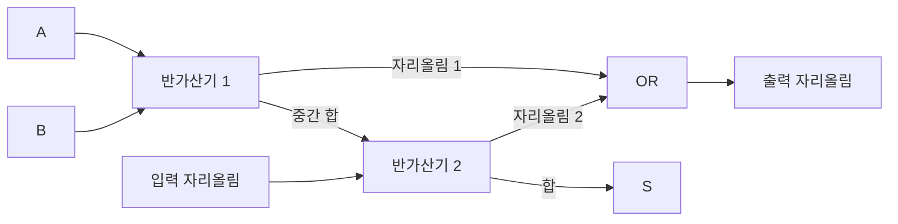

# 03. 논리회로

[목차로 돌아가기](./README.md) · [이전: 데이터 표현과 컴퓨터 산술](./02_데이터_표현과_컴퓨터_산술.md)

> 선수 개념 : [02단원](./02_데이터_표현과_컴퓨터_산술.md)의 2진수와 이진 덧셈.

## 1. 본문 개념 설명

### 1.1 논리값과 논리식의 표기

- **논리값** : 실제 전압 범위를 0과 1로 구분한 값.

- **양논리** : 높은 전압 수준을 1, 낮은 전압 수준을 0으로 해석하는 방식.

이 단원은 양논리를 기준으로 한다. 논리 1에 해당하는 실제 전압은 회로 규격마다 다르다.

이 단원에서는 다음 표기를 사용한다.

| 표기 | 뜻 | 예 |
|---|---|---|
| A′ | NOT A, A의 부정 | A=0이면 A′=1 |
| AB 또는 A·B | A AND B | 둘 다 1일 때 1 |
| A+B | A OR B | 하나 이상 1일 때 1 |
| A⊕B | A XOR B | 두 값이 다를 때 1 |
| Q, Q⁺ | 현재 상태, 다음 상태 | 클록 사건 전후의 저장값 |

**논리식의 +는 OR**를 의미한다. 부울 대수에서 `1+1=1`이며, 이진 산술 덧셈의 `1+1=10`과 구분해야 한다. 연산 우선순위는 일반적으로 NOT, AND, OR 순서다. 헷갈릴 수 있는 식에는 괄호를 쓴다.

---

### 1.2 기본 논리 게이트

- **논리 게이트** : 입력 논리값에 따라 출력을 결정하는 기본 회로.

- **진리표(Truth Table)** : 가능한 모든 입력 조합과 대응 출력을 정리한 표.

입력 변수 n개에 대한 조합 수는 2ⁿ개다.

| A | B | AND AB | OR A+B | XOR A⊕B | NAND (AB)′ | NOR (A+B)′ | XNOR (A⊕B)′ |
|:---:|:---:|:---:|:---:|:---:|:---:|:---:|:---:|
| 0 | 0 | 0 | 0 | 0 | 1 | 1 | 1 |
| 0 | 1 | 0 | 1 | 1 | 1 | 0 | 0 |
| 1 | 0 | 0 | 1 | 1 | 1 | 0 | 0 |
| 1 | 1 | 1 | 1 | 0 | 0 | 0 | 1 |

- **NOT** : 입력 하나를 반전하는 게이트. 0→1, 1→0.

- **NAND** : AND의 부정. 모든 입력이 1일 때만 0.

- **NOR** : OR의 부정. 모든 입력이 0일 때만 1.

- **2입력 XOR** : 두 입력이 다를 때 1.

- **2입력 XNOR** : 두 입력이 같을 때 1.

XOR를 여러 입력에 반복 적용하면 1의 개수가 홀수일 때 출력이 1이다. 따라서 3입력 XOR를 ‘정확히 하나만 1일 때 1’이라고 설명하면 틀린다. 111에서도 출력은 1이다.

---

### 1.3 부울 대수의 기본 법칙

- **부울 대수(Boolean Algebra)** : 0과 1을 사용하는 논리식의 연산과 변형을 다루는 대수 체계.

논리식을 간소화하면 필요한 게이트 수와 논리 단계를 줄일 수 있다. 실제 지연시간에는 게이트 종류와 배선도 영향을 준다.

| 법칙 | OR 형태 | AND 형태 |
|---|---|---|
| 항등 | A+0=A | A·1=A |
| 지배 | A+1=1 | A·0=0 |
| 멱등 | A+A=A | A·A=A |
| 보수 | A+A′=1 | A·A′=0 |
| 교환 | A+B=B+A | AB=BA |
| 결합 | (A+B)+C=A+(B+C) | (AB)C=A(BC) |
| 분배 | A+BC=(A+B)(A+C) | A(B+C)=AB+AC |
| 흡수 | A+AB=A | A(A+B)=A |

이중 부정은 `(A′)′=A`다. 일반 산술에서는 익숙하지 않은 `A+BC=(A+B)(A+C)`도 부울 대수에서는 성립한다.

흡수법칙 `A+AB=A`는 경우를 나눠 보면 이해하기 쉽다. A가 1이면 B와 관계없이 전체가 1이고, A가 0이면 AB도 0이므로 전체가 0이다. 결국 출력은 A와 같다.

### 예제: 부울 대수로 간소화

> 대상 식 : `F=AB+A′B+AB′`

```text
F = (A+A′)B + AB′       ← 앞의 두 항에서 B를 묶음
  = B + AB′             ← A+A′=1
  = (B+A)(B+B′)         ← 분배법칙
  = (A+B)·1
  = A+B
```

A와 B가 모두 0일 때만 0이고 나머지는 1이므로 OR 진리표와 같다. 식 변형이 불안하면 입력 네 가지를 대입해 검산할 수 있다.

---

### 1.4 드모르간 법칙과 범용 게이트

- **드모르간 법칙(De Morgan's Laws)** : 묶음 전체를 부정할 때 AND와 OR를 서로 바꾸고 각 항도 부정하는 법칙.

```text
(AB)′ = A′ + B′
(A+B)′ = A′B′
```

예를 들어 `(A+BC)′ = A′(BC)′ = A′(B′+C′)`다. 연산자만 바꾸거나 변수만 반전하면 틀린 식이 된다.

- **범용 게이트(Universal Gate)** : 한 종류만으로 NOT·AND·OR를 모두 구현할 수 있는 게이트. NAND와 NOR가 해당한다.

| 구현할 기능 | NAND만 사용 | NOR만 사용 |
|---|---|---|
| NOT A | NAND(A,A) | NOR(A,A) |
| A AND B | NAND(NAND(A,B), NAND(A,B)) | NOR(NOR(A,A), NOR(B,B)) |
| A OR B | NAND(NAND(A,A), NAND(B,B)) | NOR(NOR(A,B), NOR(A,B)) |

첫째 행처럼 입력을 같은 신호에 연결하면 NOT이 된다. 나머지는 출력 반전 또는 드모르간 법칙을 이용한 구성이다.

---

### 1.5 최소항, 최대항, 표준형

- **최소항(Minterm)** : 모든 변수가 한 번씩 나타나는 AND 항. 특정 입력 조합에서만 1.

변수 순서를 A, B, C로 정하면 입력 `101`에서만 1인 최소항은 `AB′C`다. 입력이 1인 변수는 그대로, 0인 변수는 부정해서 곱한다. 이 행의 번호는 이진수 101의 값인 5이므로 m₅라고 적는다.

- **최소항의 합(표준 SOP, Sum of Products)** : 출력이 1인 행의 최소항들을 OR로 연결한 표현.

```text
F(A,B,C) = Σm(1,3,5,7)
          = A′B′C + A′BC + AB′C + ABC
```

- **최대항(Maxterm)** : 모든 변수가 한 번씩 나타나는 OR 항. 특정 입력 조합에서만 0.

입력 `101`의 최대항은 `A′+B+C′`다. 1인 변수는 부정하고 0인 변수는 그대로 써야 해당 입력에서 전체 OR 항이 0이 된다.

- **최대항의 곱(표준 POS, Product of Sums)** : 출력이 0인 행의 최대항들을 AND로 연결한 표현.

```text
F(A,B,C) = ΠM(0,2,4,6)
```

위의 Σm과 ΠM은 같은 함수를 표현한다. 함수가 1인 행과 0인 행을 각각 사용했기 때문이다. 최소항이라는 이름이 곧 ‘가장 간단한 식’이라는 뜻은 아니다. 간소화 전의 최소항에는 모든 변수가 들어간다.

---

### 1.6 카르노 맵

- **카르노 맵(Karnaugh Map)** : 한 비트만 다른 입력 조합을 이웃하게 배치해 논리식을 간소화하는 표.

이웃한 항을 묶으면 값이 변하는 변수를 제거할 수 있다.

3변수 맵은 행에 A, 열에 BC를 두면 다음과 같이 만든다. 열 순서가 `00, 01, 11, 10`이라는 점에 주의한다. 이것은 이웃한 코드가 한 비트만 다른 그레이 코드 순서다.

| A \ BC | 00 | 01 | 11 | 10 |
|:---:|:---:|:---:|:---:|:---:|
| 0 | m₀ | m₁ | m₃ | m₂ |
| 1 | m₄ | m₅ | m₇ | m₆ |

곱의 합 형태로 간소화하려면 1인 칸을 묶는다.

1. 묶음의 칸 수는 1, 2, 4, 8처럼 2의 거듭제곱이어야 한다.
2. 묶음은 직사각형이어야 한다. 대각선이나 L자 모양은 안 된다.
3. 가능한 큰 묶음으로 덮되 모든 1을 최소 한 번은 포함한다.
4. 같은 칸을 여러 묶음에서 사용해도 된다.
5. 맨 왼쪽과 맨 오른쪽, 맨 위와 맨 아래도 이웃으로 본다.
6. 묶음에서 값이 바뀌는 변수는 없애고, 고정된 변수만 남긴다.

n변수 맵에서 2ᵏ칸을 묶으면 변수 k개가 제거된다. 단순히 가장 큰 묶음 하나만 찾는 것이 아니라, 전체 1을 적은 항으로 덮는지 확인해야 한다.

### 예제: 카르노 맵의 경계 묶기

`F(A,B,C)=Σm(0,2,5,7)`을 간소화한다.

| A \ BC | 00 | 01 | 11 | 10 |
|:---:|:---:|:---:|:---:|:---:|
| 0 | 1 ① | 0 | 0 | 1 ① |
| 1 | 0 | 1 ② | 1 ② | 0 |

①은 맨 왼쪽과 맨 오른쪽의 두 칸을 묶는다. A=0, C=0은 고정이고 B만 변하므로 `A′C′`가 남는다. ②는 A=1, C=1이 고정이고 B가 변하므로 `AC`가 남는다.

```text
F = A′C′ + AC = (A⊕C)′
```

출력은 B와 관계없이 A와 C가 같으면 1이다. 양 끝을 이웃으로 보지 않으면 간소화할 수 있는 항을 놓치게 된다.

### 무관 조건과 합의 곱 표현

- **무관 조건(Don't Care)** : 특정 입력에서 출력이 0 또는 1 중 어느 값이어도 허용되는 조건. X 또는 d로 표시.

간소화에 유리할 때만 묶음에 포함하며 X를 모두 덮을 필요는 없다. 출력이 정해진 입력을 임의로 X로 바꾸면 안 된다.

0인 칸을 묶어 합의 곱 형태로 간소화할 수도 있다. 이때 묶음에서 0으로 고정된 변수는 그대로, 1로 고정된 변수는 부정해 OR 항을 만든다. 1을 묶을 때와 표기 규칙이 반대다.

### 예제: 무관 조건 이용

`F(A,B,C)=Σm(1,3,7)`, 무관 조건 `d(5)`라고 하자.

| A \ BC | 00 | 01 | 11 | 10 |
|:---:|:---:|:---:|:---:|:---:|
| 0 | 0 | 1 | 1 | 0 |
| 1 | 0 | X | 1 | 0 |

X를 1처럼 사용하면 가운데 네 칸을 묶을 수 있다. A와 B는 변하고 C=1만 유지되므로 `F=C`로 구현할 수 있다. 이 회로는 입력 101에서 1을 출력하지만 해당 입력이 무관 조건이므로 허용된다.

---

### 1.7 조합논리회로

- **조합논리회로(Combinational Logic Circuit)** : 저장 상태 없이 현재 입력으로 출력이 결정되는 회로. 예) 가산기, 디코더, 멀티플렉서.

실제 게이트에는 전파 지연이 있으므로 입력이 바뀐 즉시 출력이 안정되는 것은 아니다.

참고 : [Computation Structures 조합논리 자료](https://computationstructures.org/notes/combinational_logic/notes.html)

### 반가산기와 전가산기

- **반가산기(HA, Half Adder)** : 1비트 입력 A와 B를 더해 합 S와 자리올림 C를 출력하는 회로. 이전 자리의 자리올림 입력은 없음.

```text
S = A⊕B
C = AB
```

- **전가산기(FA, Full Adder)** : A, B, 이전 자리의 자리올림 Cᵢₙ을 더해 합 S와 다음 자리올림 Cₒᵤₜ을 출력하는 회로.

```text
S = A⊕B⊕Cᵢₙ
Cₒᵤₜ = AB + ACᵢₙ + BCᵢₙ
      = AB + (A⊕B)Cᵢₙ
```

입력 세 개 중 두 개 이상이 1이면 자리올림이 생긴다.

| A | B | Cᵢₙ | S | Cₒᵤₜ |
|:---:|:---:|:---:|:---:|:---:|
| 0 | 0 | 0 | 0 | 0 |
| 0 | 0 | 1 | 1 | 0 |
| 0 | 1 | 0 | 1 | 0 |
| 0 | 1 | 1 | 0 | 1 |
| 1 | 0 | 0 | 1 | 0 |
| 1 | 0 | 1 | 0 | 1 |
| 1 | 1 | 0 | 0 | 1 |
| 1 | 1 | 1 | 1 | 1 |

전가산기는 반가산기 2개와 OR 게이트 1개로 구성할 수 있다. 여러 전가산기의 자리올림을 연결하면 다중 비트 가산기가 된다. 단순한 리플 캐리 가산기는 아래 자리에서 위 자리로 자리올림이 전파될 때까지 기다리므로 비트 수가 늘수록 이 경로의 지연이 커진다.

### 전가산기의 구성

아래 도식은 반가산기 두 개로 전가산기를 구성한 것이다. 첫 반가산기의 합을 두 번째 반가산기로 보내고, 두 자리올림을 OR로 합친다.



그림의 관계를 식으로 쓰면 `P=A⊕B`, `S=P⊕Cᵢₙ`, `Cₒᵤₜ=AB+PCᵢₙ`이다. A=B=Cᵢₙ=1이면 P=0, S=1, Cₒᵤₜ=1이므로 산술 결과 3, 즉 이진수 11이 된다.

### 디코더와 인코더

- **디코더(Decoder)** : n비트 입력 코드를 해독해 최대 2ⁿ개 출력 중 대응하는 출력을 활성화하는 회로.

예 : 활성 High 2→4 디코더에서 Enable이 허용된 상태라면 입력 10일 때 Y₂만 1.

```text
Y₀=A′B′, Y₁=A′B, Y₂=AB′, Y₃=AB
```

주소 선택이나 명령어 해독 등에 활용한다. Enable 입력이 있거나 활성 Low 출력이면 활성 조건을 별도로 확인해야 한다.

- **인코더(Encoder)** : 활성화된 입력의 번호를 이진 코드로 변환하는 회로.

- **단순 인코더** : 입력 하나만 활성화된다고 가정

- **우선순위 인코더** : 여러 입력이 활성화되면 정해진 우선순위에 따라 하나를 선택

### 멀티플렉서와 디멀티플렉서

- **멀티플렉서(MUX, Multiplexer)** : 여러 데이터 입력 중 하나를 선택해 출력하는 회로.

- 선택선 수 : 2ⁿ개 데이터 입력에 대해 n개.

2→1 MUX의 입력이 I₀, I₁이고 선택선이 S라면 다음과 같다.

```text
Y = S′I₀ + SI₁
S=0이면 I₀, S=1이면 I₁을 출력한다.
```

### 예제: MUX의 선택선

8→1 MUX에 선택선 S₂, S₁, S₀가 있고 S₂를 최상위 비트로 사용한다고 하자. 선택값이 101이면 이진수 5이므로 I₅를 출력한다. 입력이 8개라서 선택선도 8개 필요한 것이 아니다.

2→1 MUX로 함수 `F=A′B+AC`를 만들려면 선택선 S에 A를, I₀에 B를, I₁에 C를 연결하면 된다. A=0이면 B, A=1이면 C가 출력된다.

### 디멀티플렉서

- **디멀티플렉서(DEMUX, Demultiplexer)** : 하나의 데이터 입력을 선택된 출력 경로로 분배하는 회로.

디코더는 코드 해독, DEMUX는 데이터 분배에 사용한다. 디코더의 Enable에 데이터를 넣어 DEMUX처럼 구성할 수도 있다.

---

### 1.8 순서논리회로와 클록

- **순서논리회로(Sequential Logic Circuit)** : 현재 입력과 저장된 상태에 따라 동작이 결정되는 회로.

- 구성 : 조합회로 + 기억 요소 + 상태 되먹임 경로. 같은 입력이라도 현재 상태가 다르면 다음 상태가 달라질 수 있다.

참고 : [Computation Structures 순서논리 자료](https://computationstructures.org/notes/sequential_logic/notes.html)

- **클록(Clock)** : 회로의 동작 시점을 맞추는 주기적인 신호.

- **상승 에지** : 클록이 0→1로 변하는 순간.

- **하강 에지** : 클록이 1→0으로 변하는 순간.

- 주기와 주파수의 관계 : `T=1/f`

- **설정 시간(Setup Time)** : 저장 시점 직전에 입력이 안정되어 있어야 하는 최소 시간.

- **유지 시간(Hold Time)** : 저장 시점 직후에도 입력을 유지해야 하는 최소 시간.

- **준안정 상태(Metastability)** : 출력이 안정적인 0 또는 1로 정해지는 데 시간이 걸리는 상태.

설정·유지 시간 조건을 위반하면 준안정 상태가 발생할 수 있다.

---

### 1.9 래치와 플립플롭

래치와 플립플롭은 모두 1비트 기억소자이며, 입력을 받아들이는 시점에 차이가 있다.

- **래치(Latch)** : 특정 신호 레벨에서 입력을 받아들이는 기억소자.

- **플립플롭(Flip-Flop)** : 지정된 클록 에지에서 입력을 받아들이는 기억소자.

동작 예 : 활성 High D 래치는 Enable=1인 동안 D를 따라 출력이 변하고, Enable=0이면 값을 유지한다. 에지 트리거 D 플립플롭은 지정된 에지에서만 D를 저장하고 에지 사이에는 값을 유지한다.

자료에 따라 SR 래치를 SR 플립플롭이라고 부르기도 한다. 이름만 보고 판단하기보다 레벨 반응인지 에지 반응인지 확인한다.

### SR 기억소자

아래 표는 NOR 게이트를 교차 연결한 활성 High SR 래치 기준이다. S는 Set, R은 Reset이다.

| S | R | Q⁺ | 의미 |
|:---:|:---:|:---:|---|
| 0 | 0 | Q | 유지 |
| 0 | 1 | 0 | 리셋 |
| 1 | 0 | 1 | 세트 |
| 1 | 1 | 금지 | 두 출력이 모두 0이 되어 상보 관계가 깨짐 |

S=R=1을 동시에 해제하면 최종 상태가 지연 차이에 따라 달라질 수 있다. NAND로 구성한 활성 Low SR 래치는 입력 규칙이 다르다. 입력을 S̅, R̅로 표시할 때 11은 유지이고 00이 금지다. SR의 금지 입력은 구현 조건과 함께 외워야 한다.

### D, JK, T 플립플롭

다음 표는 유효 클록 에지에서의 상태 변화이며 비동기 preset/clear는 비활성이라고 가정한다.

| 종류 | 입력 조건 | 다음 상태 Q⁺ |
|---|---|---|
| D | D=0 / D=1 | 입력 D와 같음 |
| JK | J=0, K=0 | 현재 상태 유지 |
| JK | J=0, K=1 | 0으로 리셋 |
| JK | J=1, K=0 | 1로 세트 |
| JK | J=1, K=1 | 현재 상태 반전 |
| T | T=0 | 현재 상태 유지 |
| T | T=1 | 현재 상태 반전 |

특성식으로는 `D: Q⁺=D`, `JK: Q⁺=JQ′+K′Q`, `T: Q⁺=T⊕Q`다. JK의 입력 두 개를 묶으면 T 동작을 얻을 수 있다. J=K=1인 JK는 클록 에지마다 반전한다.

레벨 트리거 JK에서 클록 활성 구간이 충분히 길면 반복 반전되는 레이스 어라운드 문제가 생길 수 있다. 에지 트리거 방식이나 적절한 마스터-슬레이브 구성으로 이를 방지한다. 에지 트리거 JK의 11 동작을 금지 상태로 취급하면 안 된다.

### 예제: JK 플립플롭의 상태 추적

초기 Q=0인 상승 에지 트리거 JK 플립플롭이다. 각 입력은 에지 전후에 안정되어 있다고 가정한다.

| 상승 에지 | J | K | 동작 | 에지 후 Q |
|:---:|:---:|:---:|---|:---:|
| 1 | 1 | 0 | 세트 | 1 |
| 2 | 0 | 0 | 유지 | 1 |
| 3 | 1 | 1 | 반전 | 0 |
| 4 | 0 | 1 | 리셋 | 0 |
| 5 | 1 | 1 | 반전 | 1 |

유지와 반전은 이전 Q를 알아야 결과를 구할 수 있다. 이것이 현재 입력만으로 출력이 정해지는 조합회로와 다른 점이다.

---

### 1.10 레지스터와 카운터

- **레지스터** : 여러 비트를 함께 저장하는 회로.

- n비트 저장에 필요한 기본 기억소자 : 1비트 플립플롭 n개

- 제어 회로를 결합해 구현하는 기능 : 병렬 적재, 유지, 시프트

- **시프트 레지스터** : 클록에 맞춰 저장 비트를 옆 자리로 이동하는 레지스터.

| 종류 | 입력 | 출력 |
|---|---|---|
| SISO | 직렬 | 직렬 |
| SIPO | 직렬 | 병렬 |
| PISO | 병렬 | 직렬 |
| PIPO | 병렬 | 병렬 |

- **카운터(Counter)** : 클록 사건에 따라 정해진 상태 순서를 반복하는 계수 회로.

- n개 플립플롭으로 표현 가능한 최대 상태 수 : 2ⁿ개

- **모듈러스(M)** : 한 주기에 사용하는 서로 다른 상태의 수

- **MOD-M 카운터** : M개 상태를 순환하는 카운터

- MOD-M 카운터의 최소 플립플롭 수 : `⌈log₂M⌉`

최소 개수 공식은 이진 상태 부호화 기준이다. 상태마다 별도 비트를 할당하는 one-hot 구성에는 그대로 적용하지 않는다.

| 종류 | 클록 연결 | 특징 |
|---|---|---|
| 비동기식, 리플 카운터 | 앞 플립플롭의 출력이 다음 플립플롭의 클록을 구동 | 상태 변화가 순차 전파되어 지연이 누적된다. |
| 동기식 카운터 | 모든 플립플롭이 공통 클록을 사용 | 입력 논리로 반전 조건을 정한다. |

4비트 이진 카운터는 0~15의 16개 상태를 표현할 수 있다. MOD-10 카운터는 0~9의 10개 상태를 사용하도록 다음 상태 논리를 구성한다. 플립플롭 4개를 연결하기만 하면 자동으로 MOD-10이 되는 것은 아니다. 사용하지 않는 상태에서 어떻게 복귀할지도 설계 시 고려한다.

### 예제: 카운터 크기와 주파수

MOD-10 카운터에 필요한 최소 플립플롭 수를 구하면 `2³=8<10≤16=2⁴`이므로 4개다.

T=1인 이상적인 T 플립플롭에 8 MHz 클록을 넣으면 매 유효 에지마다 Q가 반전한다.

출력 한 주기를 완성하려면 입력 클록 두 주기가 필요하므로 출력 주파수는 4 MHz다. 이를 리플 방식으로 3단 연결해 각 단이 정상적으로 토글한다면 마지막 출력은 `8 MHz / 2³ = 1 MHz`다. 실제 동작 가능 주파수는 전파 지연과 타이밍 조건의 제한을 받는다.

## 2. 핵심 비교와 혼동 포인트

- OR와 XOR : 11에서 OR는 1, XOR는 0이다.

- 논리 덧셈과 산술 덧셈 : 논리식의 1+1은 1이며 자리올림을 만들지 않는다.

- 최소항과 최대항 : 해당 입력에서 최소항은 1, 최대항은 0이다.

- 카르노 맵의 인접 : 한 변수만 다르며 경계도 이어진다. 대각선은 인접하지 않는다.

- 무관 조건과 0 : 무관 조건은 필요할 때 1처럼 쓸 수 있지만 지정된 0은 그러면 안 된다.

- 반가산기와 전가산기 : 이전 자리의 자리올림 입력 유무가 다르다.

- 디코더와 MUX : 디코더는 입력 코드를 해독하고 MUX는 데이터 중 하나를 선택한다.

- 조합회로와 순서회로 : 저장된 상태가 다음 동작에 영향을 주는지 확인한다.

- 래치와 플립플롭 : 레벨에 반응하는지 에지에 반응하는지 구분한다.

- SR과 JK : 활성 High SR의 11은 금지지만 JK의 11은 반전이다.

- n비트 레지스터와 MOD-n 카운터 : 전자는 n비트 저장, 후자는 n개 상태 순환이다.

- 동기식과 비동기식 카운터 : 공통 클록인지 앞 단계 출력으로 다음 단계를 구동하는지 확인한다.

회로 문제를 풀기 전에 입력·출력이 활성 High인지 Low인지, 상승 에지인지 하강 에지인지, 초기 Q가 주어졌는지부터 확인한다. 표를 외워도 조건이 달라지면 그대로 적용할 수 없다.

## 3. 예시 문제

### 문제 1. 논리 게이트

2입력 게이트 중 두 입력이 같을 때 1을 출력하는 것은?

- ① AND
- ② OR
- ③ XOR
- ④ XNOR

### 문제 2. 드모르간 법칙

`(A+BC)′`와 같은 식은?

- ① A′+B′C′
- ② A′(B′+C′)
- ③ A′BC
- ④ A′+B′+C′

### 문제 3. 논리식 간소화

`AB+AB′`를 간소화한 것은?

- ① A
- ② B
- ③ A+B
- ④ AB

### 문제 4. 카르노 맵

변수 순서가 A, B, C일 때 `F=Σm(0,2,4,6)`의 간소화 결과는?

- ① A′
- ② B′
- ③ C′
- ④ C

### 문제 5. 무관 조건

카르노 맵의 무관 조건에 관한 설명으로 옳은 것은?

- ① 모든 X를 반드시 1로 처리하고 묶어야 한다.
- ② 출력이 0으로 지정된 입력도 편의에 따라 X로 바꿀 수 있다.
- ③ 간소화에 유리하면 묶음에 포함하고 그렇지 않으면 제외할 수 있다.
- ④ X를 포함하면 세 칸짜리 묶음도 허용된다.

### 문제 6. 전가산기

전가산기의 A=1, B=0, Cᵢₙ=1이다. 합 S와 자리올림 Cₒᵤₜ은?

- ① S=0, Cₒᵤₜ=0
- ② S=0, Cₒᵤₜ=1
- ③ S=1, Cₒᵤₜ=0
- ④ S=1, Cₒᵤₜ=1

### 문제 7. MUX

32개의 데이터 입력 중 하나를 선택하는 MUX에 필요한 최소 선택선 수는? 별도 Enable 신호는 제외한다.

- ① 4
- ② 5
- ③ 16
- ④ 32

### 문제 8. 회로 분류

다음 중 저장 상태를 사용하는 순서논리회로는?

- ① 디코더
- ② 반가산기
- ③ 멀티플렉서
- ④ 카운터

### 문제 9. SR 래치

NOR 게이트로 구성한 활성 High SR 래치에서 금지 입력은?

- ① S=0, R=0
- ② S=0, R=1
- ③ S=1, R=0
- ④ S=1, R=1

### 문제 10. JK 상태 변화

초기 Q=1인 JK 플립플롭에 각 유효 에지마다 `(J,K)=(1,1), (0,0), (1,0), (1,1)`을 순서대로 입력했다. 각 에지 직후 Q의 값을 순서대로 쓰시오.

### 문제 11. 카운터

MOD-12 이진 부호화 카운터에 필요한 최소 플립플롭 수와 그 비트 수에서 사용하지 않는 상태 수는?

- ① 3개, 4개
- ② 4개, 4개
- ③ 4개, 12개
- ④ 12개, 0개

### 문제 12. MUX로 함수 구현

2→1 MUX의 출력이 `Y=S′I₀+SI₁`이다. `F=A′B+AB′`를 구현하려고 S=A로 연결했다. I₀와 I₁에 각각 무엇을 연결해야 하는가? 이 함수의 게이트 이름도 쓰시오.

### 문제 13. 최소항과 최대항

변수 순서 A, B, C에서 입력 110에 대응하는 최소항 m₆과 최대항 M₆을 각각 쓰시오.

### 문제 14. D 플립플롭

상승 에지 트리거 D 플립플롭의 초기 Q는 0이다. D가 1로 바뀌었지만 아직 상승 에지가 오지 않았다. 다음 상승 에지 직전·직후의 Q는? D는 설정·유지 시간을 만족하며 1을 유지한다.

- ① 0, 0
- ② 0, 1
- ③ 1, 0
- ④ 1, 1

## 4. 정답과 해설

### 문제 1 — ④

XNOR는 00과 11에서 1이다.

- ① AND는 11에서만 1이므로 00 조건을 만족하지 않는다.
- ② OR는 00에서 0이고 서로 다른 입력에서도 1이다.
- ③ XOR는 두 입력이 다를 때 1이다.

### 문제 2 — ②

전체 OR를 부정하면 `A′(BC)′`이고, 다시 드모르간 법칙을 적용하면 `A′(B′+C′)`다.

- ①은 바깥 OR를 AND로 바꾸지 않았고 내부 처리도 틀렸다.
- ③은 BC에 대한 부정을 빠뜨렸다.
- ④는 전체 AND의 부정 `(ABC)′`에 해당한다.

### 문제 3 — ①

공통 A를 묶으면 `A(B+B′)=A·1=A`다. B가 무엇이든 A가 출력된다.

- ②는 남는 변수를 잘못 골랐다.
- ③은 A=0, B=1에서 원래 식과 다르고, ④는 A=1, B=0에서 원래 식과 다르다.

### 문제 4 — ③

0, 2, 4, 6을 3비트로 쓰면 000, 010, 100, 110이다. A와 B는 변하지만 C는 모두 0이므로 C′다.

- ①·②는 각각 A와 B가 0인 입력 집합을 나타낸다.
- ④는 홀수 번호의 최소항 1, 3, 5, 7에서 1이다.

### 문제 5 — ③

X는 출력이 어느 쪽이어도 허용되므로 간소화에 도움이 될 때 사용한다.

- ① 모두 포함할 의무는 없다.
- ② 출력이 정해진 조건을 임의로 바꿀 수는 없다.
- ④ X를 사용해도 묶음 크기는 2의 거듭제곱이어야 한다.

### 문제 6 — ②

산술적으로 `1+0+1=2=(10)₂`이므로 S=0, Cₒᵤₜ=1이다. 식으로도 `S=1⊕0⊕1=0`, `Cₒᵤₜ=0+1+0=1`이다.

- ①·③·④는 각각 합계 0, 1, 3에 해당한다.

### 문제 7 — ②

선택선 n개가 2ⁿ개의 입력을 구분하므로 `2⁵=32`에서 5개다.

- ① 4개로는 16개만 선택한다.
- ③·④는 최소 개수가 아니며 데이터 입력 수와 선택선 수를 혼동한 값이다.

### 문제 8 — ④

카운터는 현재 상태를 기억하고 다음 클록에 어떤 상태로 갈지 정한다.

- ① 디코더, ② 반가산기, ③ MUX는 기본적으로 현재 입력만으로 출력을 정하는 조합회로다.

### 문제 9 — ④

활성 High NOR SR 래치의 11은 두 출력을 모두 0으로 강제해 상보 관계를 깨뜨린다.

- ①은 유지, ②는 리셋, ③은 세트다. 활성 Low NAND SR 래치의 표와 바꾸어 적용하지 않도록 한다.

### 문제 10 — 0, 0, 1, 0

초기 1에서 11은 반전이므로 0이 된다. 다음 00은 유지하므로 0, 10은 세트이므로 1, 마지막 11은 반전이므로 0이다. JK의 11은 금지 조건이 아니다.

### 문제 11 — ②

`2³=8<12≤16=2⁴`이므로 최소 4개가 필요하다. 전체 16개 비트 상태 중 12개를 정상 순환에 사용하므로 남는 상태는 `16-12=4개`다.

- ①은 12개 상태를 표현하지 못한다.
- ③은 사용 상태와 미사용 상태를 혼동했다.
- ④는 상태마다 플립플롭 하나를 두는 구성을 떠올린 것으로 최소 이진 부호화 조건과 다르다.

### 문제 12 — I₀=B, I₁=B′, XOR

S=A를 대입하면 `Y=A′I₀+AI₁`이다. 목표 식과 항을 맞추면 I₀=B, I₁=B′가 된다. 출력은 A와 B가 다를 때 1이므로 XOR다.

### 문제 13 — m₆=ABC′, M₆=A′+B′+C

최소항은 입력 110에서 1이어야 하므로 `1·1·1`이 되도록 ABC′를 쓴다. 최대항은 같은 입력에서 0이어야 하므로 `0+0+0`이 되도록 A′+B′+C를 쓴다. 두 항의 변수 부정 규칙이 반대임을 확인한다.

### 문제 14 — ②

상승 에지가 오기 전에는 기존 Q=0을 유지한다. 상승 에지에서 D=1을 저장하므로 이후 Q=1이 된다.

- ①은 에지에서의 갱신을 빠뜨렸다.
- ③은 입력값과 반대로 동작한다고 보았고, ④는 에지가 오기 전부터 D를 따라가는 래치의 동작과 혼동했다.
